# 7RAYS ASTRO VASTU — INTERNAL LINK GRAPH & ARCHITECTURE FORENSICS
**Document ID**: SEO_FORENSIC_INTERNAL_LINK_GRAPH.md  
**Date of Audit**: October 14, 2026  
**Auditor**: Search Architecture & Semantic Linking Specialist  

---

## 1. Information Architecture Overview

The site architecture is designed around a **Hub-and-Spoke Pillar Model** branching from the Homepage into three primary operational silos:
1. **Vastu Shastra Services** (`/vastu-services` → `/vastu/*`)
2. **Vedic Astrology Services** (`/astrology` → `/astrology/*`)
3. **Bangalore Local Service Hub** (`/locations/bangalore` → `/locations/*`)
4. **Insights & Editorial Research** (`/insights` → `/blog/*`)
5. **Illustrative Case Studies** (`/case-studies` → `/case-studies/*`)

---

## 2. Structural Architecture Diagram

```mermaid
graph TD
    Home["Homepage (/)"]
    
    %% Core Brand Silo
    subgraph Brand_EAT ["Brand & E-E-A-T Silo"]
        About["/about"]
        Consultant["/consultant/rishwa-sinha"]
        The7Rays["/the-7-rays"]
        Process["/process"]
        Contact["/contact"]
        FAQ["/faq"]
    end
    
    %% Vastu Services Silo
    subgraph Vastu_Pillar ["Vastu Services Silo"]
        VastuHub["/vastu-services"]
        ResVastu["/vastu/residential"]
        AptVastu["/vastu/apartment-vastu"]
        CommVastu["/vastu/commercial"]
        OfficeVastu["/vastu/office-vastu"]
        CorpVastu["/vastu/corporate"]
        IndVastu["/vastu/industrial"]
        NonDemo["/vastu/non-demolition"]
        VastuAudit["/vastu-services/vastu-audit"]
        NRI["/international"]
    end

    %% Astrology Services Silo
    subgraph Astro_Pillar ["Astrology Services Silo"]
        AstroHub["/astrology"]
        BirthChart["/astrology/birth-chart"]
        CareerAstro["/astrology/career"]
        BizAstro["/astrology/business"]
        MarriageAstro["/astrology/marriage"]
    end

    %% Local Bangalore Silo
    subgraph Local_Pillar ["Bangalore Local SEO Silo"]
        BlrMaster["/locations/bangalore"]
        BlrRes["/locations/bangalore/residential-vastu"]
        BlrComm["/locations/bangalore/commercial-vastu"]
        BlrInd["/locations/bangalore/industrial-vastu"]
        BlrAudit["/locations/bangalore/vastu-audit"]
        BlrAstro["/locations/bangalore/astrology"]
        HSR["/locations/hsr-layout"]
        Indiranagar["/locations/indiranagar"]
        Koramangala["/locations/koramangala"]
        Whitefield["/locations/whitefield"]
    end

    %% Editorial Insights Silo
    subgraph Content_Pillar ["Editorial & Insights Silo"]
        InsightsHub["/insights"]
        Blog18["/blog/:slug (18 Articles)"]
        CaseStudies["/case-studies"]
        CaseStudy6["/case-studies/:slug (6 Scenarios)"]
    end

    %% Connectors
    Home --> Brand_EAT
    Home --> VastuHub
    Home --> AstroHub
    Home --> BlrMaster
    Home --> InsightsHub
    Home --> CaseStudies

    VastuHub --> ResVastu
    VastuHub --> AptVastu
    VastuHub --> CommVastu
    VastuHub --> OfficeVastu
    VastuHub --> CorpVastu
    VastuHub --> IndVastu
    VastuHub --> NonDemo
    VastuHub --> VastuAudit
    VastuHub --> NRI

    AstroHub --> BirthChart
    AstroHub --> CareerAstro
    AstroHub --> BizAstro
    AstroHub --> MarriageAstro

    BlrMaster --> BlrRes
    BlrMaster --> BlrComm
    BlrMaster --> BlrInd
    BlrMaster --> BlrAudit
    BlrMaster --> BlrAstro
    BlrMaster --> HSR
    BlrMaster --> Indiranagar
    BlrMaster --> Koramangala
    BlrMaster --> Whitefield

    InsightsHub --> Blog18
    CaseStudies --> CaseStudy6
```

---

## 3. Discovered Internal Linking Inconsistencies (Forensic Evidence)

### 3.1 Discrepancy: `/insights` Hub vs `/blog/:slug` Article URLs
- **Observation**:
  - The main header navigation, footer, and Homepage link to `/insights`.
  - The canonical for the insights directory is `https://7raysastrovastu.in/insights`.
  - However, all individual article cards within `BlogPage.tsx` link to `/blog/${article.slug}`.
  - Furthermore, `src/routes/AppRoutes.tsx` configures duplicate aliases:
    - `<Route path="/insights/:slug" element={<BlogPostPage />} />`
    - `<Route path="/blog/:slug" element={<BlogPostPage />} />`
- **Search Impact**: While `BlogPostPage.tsx` sets its canonical URL to `${siteConfig.url}/blog/${post.slug}`, crawlers that navigate through breadcrumbs receive `/insights` as parent, yet the leaf URL is `/blog/*`.
- **Recommendation**: Standardize the folder prefix across both parent and children: either use `/insights` + `/insights/:slug` consistently, or use `/blog` + `/blog/:slug` across the board, setting 301 redirects for the secondary pattern.

### 3.2 Discrepancy: `/vastu-services` vs `/services` vs `/vastu/*`
- **Observation**:
  - In `src/routes/AppRoutes.tsx`:
    - `/vastu-services` → `<ServicesPage />` (Canonical: `https://7raysastrovastu.in/vastu-services`)
    - `/services` → `<ServicesPage />` (Alias returning 200 OK)
    - `/vastu/consultation` → `<ServicesPage />` (Alias returning 200 OK)
  - In `src/pages/services/ServiceDetailPage.tsx` (line 26):
    - Canonical is generated as `${siteConfig.url}/services/${service.slug}`
  - In `src/pages/services/VastuAuditPage.tsx`:
    - Canonical is `${siteConfig.url}/vastu-services/vastu-audit`
  - In all other Vastu subpages (`ApartmentVastuPage`, `ResidentialVastuPage`, `CommercialVastuPage`):
    - Canonical is `${siteConfig.url}/vastu/${service-name}`
- **Search Impact**: Inconsistent path prefixes (`/vastu/`, `/vastu-services/`, and `/services/`) fragment internal link equity.
- **Recommendation**: Select `/vastu-services/` or `/vastu/` as the single canonical namespace for all Vastu subpages and issue permanent 301 redirects on aliases.

### 3.3 Discovered Alias Routes Serving Duplicate Content (200 OK)
The following internal routes resolve to active components without 301 redirection:
1. `/vastu/home` → renders `ResidentialVastuPage` (Canonical: `/vastu/residential`)
2. `/vastu/flat` → renders `ApartmentVastuPage` (Canonical: `/vastu/apartment-vastu`)
3. `/vastu/office` → renders `OfficeVastuPage` (Canonical: `/vastu/office-vastu`)
4. `/vastu/plot` → renders `VastuAuditPage` (Canonical: `/vastu-services/vastu-audit`)
5. `/vastu/interior` → renders `NonDemolitionVastuPage` (Canonical: `/vastu/non-demolition`)
6. `/vastu-services/residential-vastu` → renders `ResidentialVastuPage`
7. `/vastu-services/commercial-vastu` → renders `CommercialVastuPage`
8. `/vastu-services/industrial-vastu` → renders `IndustrialVastuPage`
9. `/store` and `/products` → renders `ShopPage` (Canonical: `/shop`)
10. `/astrology-consultation` → renders `AstrologyPage` (Canonical: `/astrology`)

---

## 4. Breadcrumb Navigation & Schema Consistency

### 4.1 Schema vs Visible Breadcrumbs Audit
Every core page and article implements `<BreadcrumbSchema />` utilizing `item` and `position` properties adhering to Schema.org standard.

**Verified Clean Implementation in `src/components/seo/schemas/BreadcrumbSchema.tsx`**:
- Strips redundant homepage duplicates.
- Generates absolute HTTPS URLs.
- Correct 1-based sequential positioning.

### 4.2 Breadcrumb Trace Example (Blog Article):
1. `Home` (`https://7raysastrovastu.in/`)
2. `Insights` (`https://7raysastrovastu.in/insights`)
3. `Residential Vastu` (`https://7raysastrovastu.in/insights`)
4. `Article Title` (`https://7raysastrovastu.in/blog/south-facing-house-vastu-myths`)

---

## 5. Orphan Page Analysis

- **Total Public Routes Tested**: 62
- **True Orphan Pages Found**: **0** (Every single sitemap URL is discoverable via either the primary navigation, footer site directory, locality cards, or blog pagination grid).
- **Weakly Linked Pages (Depth > 3)**:
  - Thin blog articles (articles 7, 8, 11, 12, 13) rely primarily on the paginated blog archive grid. They lack in-content contextual cross-links from high-authority service pillars.
  - Case studies 1, 3, 4 (`luxury-residence-mumbai`, `villa-goa`, `commercial-space-hyderabad`) are linked solely from the case studies index.

---

## 6. Recommended Internal Linking Upgrades

1. **Service-to-Blog Contextual Inlinks**:
   - In `ResidentialVastuPage.tsx`, insert contextual contextual links to:
     - `/blog/vastu-for-modern-apartments-in-bangalore`
     - `/blog/north-facing-house-vastu-plan`
     - `/blog/south-facing-house-vastu-myths`
   - In `CommercialVastuPage.tsx`, insert contextual links to:
     - `/blog/office-layout-executive-cabin-vastu`
     - `/blog/retail-store-and-showroom-vastu`
     - `/blog/restaurant-and-hospitality-vastu`
2. **Standardize Insights Path**:
   - Align `/insights` to `/insights/:slug` across navigation and canonicals.
3. **Deprecate Unused Direct Aliases**:
   - Add Cloudflare edge redirect rules converting `/vastu/home` → `/vastu/residential` (301).
