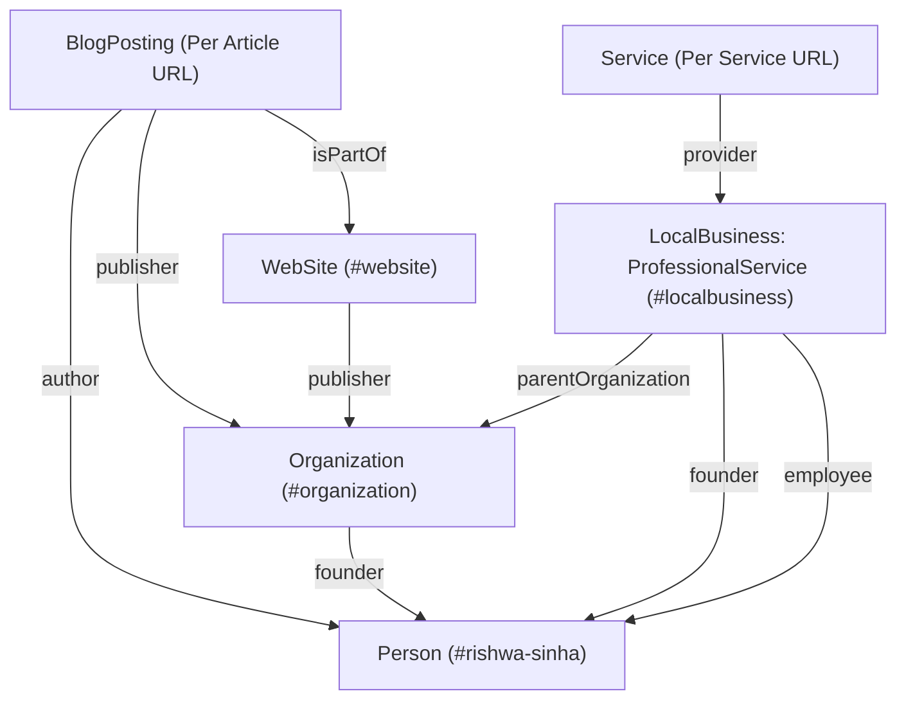

# 7RAYS ASTRO VASTU — STRUCTURED DATA & ENTITY GRAPH FORENSIC AUDIT
**Document ID**: SEO_FORENSIC_SCHEMA_AUDIT.md  
**Audit Date**: October 14, 2026  
**Auditor**: Semantic Web & Knowledge Graph Specialist  
**Standard**: Schema.org v26+, Google Search Central Structured Data Guidelines

---

## 1. Executive Summary: Structured Data

The structured data implementation is one of the **strongest components** of the 7Rays Astro Vastu codebase. It strictly eschews common black-hat practices (such as inventing 5-star aggregate ratings, fake client review quotes, or unverified certificate numbers) and constructs an interconnected **Semantic Knowledge Graph** anchored by stable `@id` URIs.

### Entity Graph Verification Matrix

| Schema Type | Component Reference | Target @id URI | Validity | Google Rich Result Eligibility |
| :--- | :--- | :--- | :---: | :--- |
| **Organization** | `OrganizationSchema.tsx` | `https://7raysastrovastu.in/#organization` | **PASS** | Valid Knowledge Panel entity |
| **Person** | `PersonSchema.tsx` | `https://7raysastrovastu.in/#rishwa-sinha` | **PASS** | Valid Author / Founder entity |
| **LocalBusiness** | `LocalBusinessSchema.tsx` | `https://7raysastrovastu.in/#localbusiness` | **PASS** | `ProfessionalService` subtype; Local Pack eligible |
| **WebSite** | `WebSiteSchema.tsx` | `https://7raysastrovastu.in/#website` | **WARNING** | SearchAction points to removed global search bar |
| **Service** | `ServiceSchema.tsx` | Dynamic / Per URL | **PASS** | Merchant/Service entity; linked to `#localbusiness` |
| **BlogPosting** | `ArticleSchema.tsx` | Dynamic / Per Article | **PASS** | Article Rich Snippet eligible |
| **BreadcrumbList** | `BreadcrumbSchema.tsx` | Dynamic / Per Page | **PASS** | Breadcrumbs Rich Snippet eligible |
| **FAQPage** | `FAQSchema.tsx` | Dynamic / Per Page | **PASS** | Deployed only on pages with visible Q&A |

---

## 2. Entity Graph Architecture & Relationships



### 2.1 Graph Node Analysis

#### 1. Node: Organization (`#organization`)
- **Type**: `Organization`
- **Identifier**: `https://7raysastrovastu.in/#organization`
- **Integrity**: Matches `legalBusinessName` and official registered address in Dasarahalli.
- **sameAs Policy**: Correctly omitted until official verified social entity accounts or Wikidata entries exist. Does not misuse Google Maps links as identity profiles.

#### 2. Node: Person (`#rishwa-sinha`)
- **Type**: `Person`
- **Identifier**: `https://7raysastrovastu.in/#rishwa-sinha`
- **Role**: Founder & Certified Vastu Consultant.
- **hasCredential Property**: Utilizes `EducationalOccupationalCredential` with `name: "Certified Vastu Consultant"`. Conforms strictly to truth rules by omitting speculative issuing IDs, URLs, or registration numbers.
- **Bidirectional Linking**: Connects to `#organization` via `worksFor`.

#### 3. Node: LocalBusiness (`#localbusiness`)
- **Type**: `ProfessionalService` (Accurate Schema.org subtype of `LocalBusiness`).
- **GeoCoordinates**: `latitude: 13.0645`, `longitude: 77.5875` (Accurately resolves to Dasarahalli 560024 headquarters).
- **hasMap**: Linked to authoritative Google Maps URL: `https://maps.app.goo.gl/wcoHwGSBggq6n3Fe9`.
- **hasOfferCatalog**: Accurately itemizes the 6 core services without fabricating pricing data.

---

## 3. Implementation Defects & Warnings

### Defect 1: WebSite SearchAction Targets Deprecated Endpoint (P2)
- **File**: `src/components/seo/schemas/WebSiteSchema.tsx` (Lines 35–39)
- **Current Code**:
  ```tsx
  potentialAction: {
    '@type': 'SearchAction',
    target: `${siteConfig.url}/blog?q={search_term_string}`,
    'query-input': 'required name=search_term_string',
  }
  ```
- **Finding**: The global search bar was previously removed from the header per user design instructions. Moreover, the query parameter `?q=` is not actively processed as a server-side or prerendered search result page on `/blog`.
- **Search Impact**: Google Sitelinks Search Box may attempt to route queries to `/blog?q=term`, which merely lands on the standard blog grid without server search execution.
- **Recommendation**: Remove `potentialAction: SearchAction` unless a dedicated, functional search result route with proper input handling is maintained.

### Defect 2: Client-Side Helmet Injection Delays Crawler Parsing (P1)
- **Finding**: All JSON-LD `<script type="application/ld+json">` elements are injected into the DOM via `react-helmet-async` on the client side.
- **Evidence**: Raw `curl -s https://7raysastrovastu.in/` yields zero JSON-LD in the initial HTML payload.
- **Search Engine Behavior**:
  - Googlebot will discover the schema during the second-phase rendering pass (WRS).
  - Social scrapers, non-rendering bots, and AI citation crawlers (Perplexity, ChatGPT Search, ClaudeBot) parse raw HTML and fail to extract the Knowledge Graph nodes.
- **Recommendation**: Prerender the core WebSite, Organization, and LocalBusiness JSON-LD scripts into `index.html` during the Vite production build step.

### Defect 3: LocalBusiness Lacks openingHoursSpecification (P3)
- **Finding**: `openingHours` is stored as `null` in `src/config/business.ts` per strict instruction not to invent business hours.
- **Impact**: Schema Markup Validator and Google Rich Results Test report an "Optional Field Missing: openingHours / openingHoursSpecification" warning.
- **Recommendation**: Retain current null status until the founder explicitly confirms operating hours (e.g. `Mo-Sa 10:00-18:00 by appointment`). Do not fabricate.

---

## 4. URL-to-Schema Distribution Matrix

| Route Category | Deployed Schemas | Rich Result Target |
| :--- | :--- | :--- |
| **Homepage (`/`)** | `Organization`, `LocalBusiness`, `Person`, `WebSite`, `BreadcrumbList` | Knowledge Panel, Local Pack, Sitelinks |
| **Core Service Pages (`/vastu/*`)** | `Service`, `LocalBusiness` (provider), `BreadcrumbList`, `FAQPage` | Service Listing, FAQ Rich Snippets |
| **Astrology Pages (`/astrology/*`)** | `Service`, `LocalBusiness`, `BreadcrumbList`, `FAQPage` | Service Listing, FAQ Rich Snippets |
| **Bangalore Local Pages (`/locations/*`)** | `LocalBusiness` (`areaServed`), `BreadcrumbList`, `FAQPage` | Local Pack & Localized Service Snippets |
| **Insights Articles (`/blog/*`)** | `BlogPosting`, `Person` (author), `Organization` (publisher), `BreadcrumbList`, `FAQPage` | Article Carousels, FAQ Rich Snippets |
| **Case Studies (`/case-studies/*`)** | `Article`, `BreadcrumbList` | Standard Search Result with Breadcrumbs |

---

## 5. Schema Markup Validator Checklist

Before opening Search Console:
1. Verify that `headline` in `ArticleSchema` does not exceed 110 characters.
2. Confirm all `datePublished` and `dateModified` strings conform to valid ISO-8601 timestamps (e.g., `2026-03-29T15:00:00+05:30`).
3. Ensure image arrays in `BlogPosting` provide absolute HTTPS URLs (`https://7raysastrovastu.in/images/...`).
